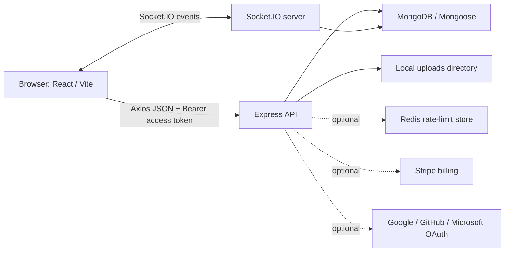
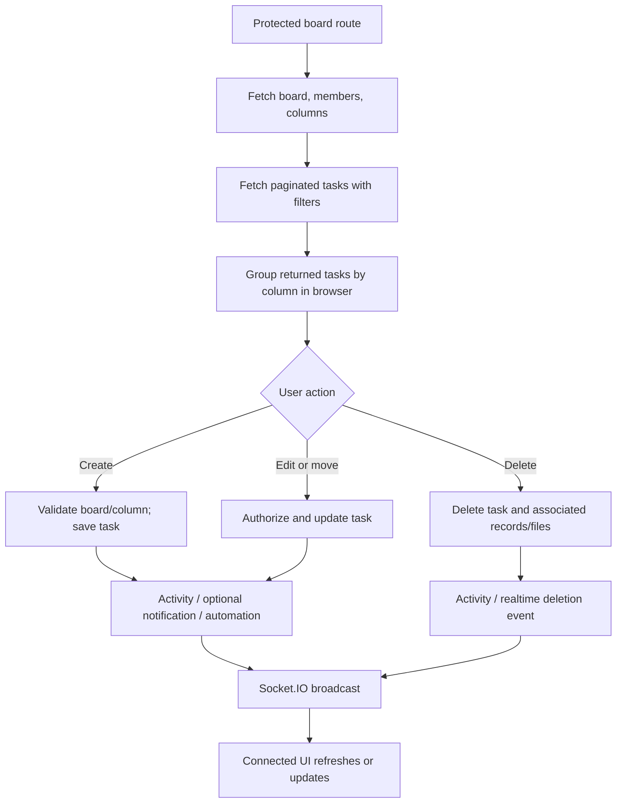

# TaskFlow — Complete Code Flow

## 1. Scope and reading guide

This document describes the application as implemented in the repository, tracing the main browser-to-server-to-database flows and listing the exposed API surface. It is based on source inspection, not a claim that every optional integration has been configured or exercised.

No application code was changed to produce this document. Environment variable **names** are listed where useful; secret values, account credentials, tokens, and private user data are intentionally omitted. Source paths below are relative to the repository root.

## 2. Project architecture

TaskFlow is a React 19 single-page application built with Vite, backed by an Express 5 API and MongoDB through Mongoose. The API also hosts Socket.IO for realtime updates. Authentication uses short-lived JWT access tokens and refresh tokens held in HttpOnly cookies. The browser stores the current user and access token in local storage.



### Main code locations

| Concern | Implementation |
|---|---|
| Browser entry and app routes | `client/src/main.jsx`, `client/src/App.jsx` |
| Shared page shell and navigation | `client/src/components/layout/` |
| Authentication state and token restoration | `client/src/context/AuthContext.jsx` |
| HTTP client, headers, response/error handling | `client/src/api/client.js` |
| Socket.IO browser connection | `client/src/api/socket.js` |
| Dashboard, boards, board/task UI | `client/src/pages/Dashboard.jsx`, `Boards.jsx`, `Board.jsx` |
| Express app, middleware, DB connection, route mounts | `server/server.js` |
| API route declarations | `server/src/routes/` |
| Request authorization and validation | `server/src/middleware/` |
| Business logic | `server/src/controllers/` and `server/src/services/` |
| MongoDB schemas and indexes | `server/src/models/` |
| Socket.IO authentication, rooms, broadcasts | `server/src/socket.js` |

The Vite app defines public routes for landing, login, registration, password recovery, and OAuth callback. `/app` and its nested dashboard, board, task, activity, notification, user, team, and settings pages are wrapped by `ProtectedRoute`. Most page modules are loaded lazily by `client/src/App.jsx`.

## 3. Application startup and request lifecycle

1. `client/src/main.jsx` mounts the React app. `App.jsx` wraps routes in `AuthProvider`, `BrowserRouter`, and a `Suspense` fallback.
2. `AuthProvider` restores the user, access token, and active organization from local storage. If a token exists, it validates it with `GET /api/users/me`, fetches organizations, and repairs an invalid saved organization selection by choosing the first returned organization. If validation fails, it attempts `POST /api/auth/refresh`; failure clears local auth state.
3. `client/src/api/client.js` creates Axios with `VITE_API_BASE_URL` (default `http://localhost:5000/api`) and credentials enabled. Its request interceptor adds the stored Bearer token and selected `x-organization-id`. The response interceptor returns the decoded JSON response body and converts API/network failures to rejected errors.
4. `server/server.js` creates the Express app and HTTP server, initializes Socket.IO, then configures request logging, Helmet, CORS, body/cookie parsing, rate limits, database connection, health endpoint, and API mounts.
5. Protected API requests pass through `authenticate`; board and organization route groups additionally apply organization and board authorization as appropriate. Route-specific validation runs before controller logic.
6. Controllers query or mutate Mongoose models, then return JSON. Feature services may persist activity/notifications, dispatch automation work, or broadcast events.

The server uses `PORT` (default `5000`) and `MONGODB_URI` (default local `taskflow` database). Other observed variable names include `NODE_ENV`, `CORS_ORIGIN`, `CLIENT_URL`, `JWT_SECRET`, `REDIS_URI`, `VITE_API_BASE_URL`, OAuth provider client IDs/secrets/callback URL, and Stripe keys/price IDs. Configure required values in the local environment; do not put secrets in source control.

The health endpoint is `GET /api/health`. It reports database connection state, process uptime, Node version, and rounded RSS/heap metrics. The server also configures rate limits for all `/api` traffic, authentication routes, and attachment uploads. If `REDIS_URI` is configured, rate-limit state is stored through Redis; otherwise the rate limiter uses its default store.

## 4. Authentication and account flows

### Password login

1. `Login.jsx` collects email and password and calls `login()` from `AuthContext`.
2. The browser sends `POST /api/auth/login`.
3. Login validation runs, then `authController.login` looks up the user, checks active/lockout state, and compares the submitted password to the bcrypt hash. Failed attempts are counted; after the configured threshold the account receives a temporary lock and an audit entry.
4. If MFA is enabled, the API responds with a short-lived MFA challenge token instead of a normal access token. The UI submits the code to `POST /api/auth/mfa/challenge`.
5. Otherwise, token issuance creates a 15-minute access JWT and a random refresh token. Only a SHA-256 hash of the refresh token is stored in a `Session`; the raw refresh token is set as an HttpOnly cookie with production-sensitive `secure` and `sameSite` flags.
6. The API returns user and access token. The browser stores them in local storage, fetches organizations, selects an active organization, updates request headers, connects the socket, and navigates into the protected app.

### Registration, refresh, logout, and identity providers

- `POST /api/auth/register` creates a user with a bcrypt password hash, creates a default organization owned by the user, and issues tokens.
- On startup, `POST /api/auth/refresh` uses the refresh cookie to rotate the session and return a new access token. Refresh-token hashes are not returned to the client.
- `POST /api/auth/logout` revokes the refresh session and clears the cookie; the client clears local user/token/organization state and disconnects the socket in its logout flow.
- Google, GitHub, and Microsoft OAuth routes use Passport when the matching provider configuration is present. The callback issues an access token and redirects to the frontend callback route.
- MFA setup, verification/enabling, disabling, and login challenge routes are declared under `/api/auth`. The UI security settings page is the corresponding frontend surface.
- User profile, password change, and session-revocation routes are protected by `authenticate`.

### Authentication flow

```mermaid
sequenceDiagram
  participant U as User
  participant UI as Login / AuthContext
  participant API as Express auth routes
  participant DB as MongoDB
  U->>UI: Enter email and password
  UI->>API: POST /api/auth/login
  API->>DB: Find user; check status and bcrypt hash
  alt MFA enabled
    API-->>UI: MFA-required response and short-lived challenge token
    UI->>API: POST /api/auth/mfa/challenge
    API->>DB: Verify challenge and MFA code
  else Password accepted
    API->>DB: Create session with refresh-token hash
  end
  API-->>UI: User + access token; HttpOnly refresh cookie
  UI->>API: GET /api/orgs
  API-->>UI: Organizations
  UI->>UI: Persist user/token/org and connect socket
```

## 5. Organization, board, and task flows

### Organization selection and authorization

`GET /api/orgs` returns organizations available to the authenticated user. Organization-scoped routes use `x-organization-id`; `requireOrganization` loads that organization and checks membership (with the implemented global-admin exception). Organization membership roles are `admin`, `manager`, and `member`. Organization creation and member management are handled by `organizationController`.

### Board list and board creation

1. The boards page calls `GET /api/boards` with the active organization header. The controller scopes results by organization and role, and may query assigned-task board IDs for users whose visibility is narrower.
2. Board creation is only offered to non-members in the current UI. The API validates the name, checks the organization’s board limit, creates the board and its initial membership, inserts three default columns (`To Do`, `In Progress`, `Done`), attempts to record activity, broadcasts `board_created`, and returns the board.
3. The board list subscribes to board events and refreshes after create/update/delete broadcasts. The create handler also inserts the returned board optimistically.
4. Opening a board calls `GET /api/boards/:boardId`; board middleware checks organization and board visibility before the controller returns the board and organization.

### Board details, task list, and task mutations

When a board opens, `Board.jsx` retrieves the board, members, and columns. The task list is separately fetched from `GET /api/boards/:boardId/tasks` with page/limit and optional search, assignee, priority, and due-date filters. The server caps page size at 100, applies role-based visibility, runs a paginated task query and a matching count query, and populates assignee display fields. The browser groups the returned page into columns using a `Map`.

- **Create:** `POST /api/boards/:boardId/tasks` validates input, rejects member task creation, verifies the selected column belongs to the board, optionally adds the assignee to board membership, calculates a trailing position if none was supplied, saves the task, records activity, broadcasts `task_created`, optionally notifies the assignee, and triggers matching automations.
- **Read:** `GET /api/boards/:boardId/tasks/:taskId` returns the board-scoped task and applies the member task-assignment check.
- **Edit:** `PATCH /api/boards/:boardId/tasks/:taskId` applies validation and controller authorization, persists allowed changes, records activity/broadcasts relevant updates, and may notify other users.
- **Move:** `PATCH /api/boards/:boardId/tasks/:taskId/move` changes the task column/order, records activity and broadcasts the move, then evaluates `task_moved` automations.
- **Delete:** `DELETE /api/boards/:boardId/tasks/:taskId` removes associated task resources and records/broadcasts the deletion according to the controller logic.

`Board.jsx` supports task pagination (“load more”), aborts an in-flight task request when starting another fetch, and refreshes task data after some mutations. It opens task details from a selected task or `taskId` URL parameter; comments and attachments can be fetched alongside the task.

### Task and board authorization details

`authenticate` verifies the access JWT and reloads an active user. `requireOrganization` resolves the organization from the request header. `authorizeBoard` loads the board, aligns the board organization with the request organization (or checks the user’s access to the board organization), then applies role rules. The implementation includes special visibility rules for members (board ownership or assigned tasks) and can auto-add certain authorized users to organization/board member arrays. Some endpoints apply further controller checks.

These are implementation details, not a general guarantee that every role sees every board. In particular, task list filtering and individual task access each contain explicit member restrictions.

### Board/task flow



## 6. Comments, attachments, activity, and notifications

### Comments

Comment routes are nested at `/api/boards/:boardId/tasks/:taskId/comments` and inherit board authorization. They list, create, update, and delete task comments. The `Comment` schema references task, board, and author, limits content to 2,000 characters, and indexes task chronology and board lookup. The controller handles comment ownership/authorization and related activity/notification behavior.

### Attachments

Attachment routes are nested at `/api/boards/:boardId/tasks/:taskId/attachments`. Uploads pass through the app-level upload rate limiter and Multer. Files are stored under the server uploads directory using generated names; the upload policy limits one file to 5 MB and checks allowed MIME types and extensions. The API supports list, download, and delete. Metadata in MongoDB links the stored file to a task, board, and uploader; deletion also attempts to remove the physical file.

### Activity

Activity is persisted through `activityService.logActivity`. It catches and logs persistence failures internally, so a failed activity write does not automatically turn the primary operation into a failed response. General activity and board activity are exposed through authenticated routes; board activity inherits board authorization. The dashboard queries the five most recently created activity entries across relevant boards.

### Notifications

The notification service stores notifications, avoids self-notification, populates sender information, and emits `notification_received` to the recipient’s user socket room. Multiple-recipient dispatch deduplicates IDs and dispatches per recipient. The notification page endpoints list the latest 50 notifications and unread count, mark one notification read, or mark all read.

## 7. Realtime and automation flows

### Socket.IO

The server initializes Socket.IO alongside the HTTP server. A socket handshake supplies an access JWT; the server verifies it and identifies the user. User-specific notifications are emitted to user rooms, while board events are sent to board rooms. `join_board` checks board access before joining; the server also maintains in-memory presence state. The browser’s `client/src/api/socket.js` manages connection and authentication. Dashboard and board-list components subscribe to relevant events and clean up listeners on unmount.

Realtime broadcasts update connected clients; HTTP requests remain the authoritative persistence path. Presence is held in server process memory and is not a durable database record.

### Automations

Board automation routes list, create, toggle, and delete automation rules. The schema currently models `task_created` and `task_moved` triggers, optional target-column conditions, and `set_priority`, `mark_complete`, and `unassign` actions. `automationService.evaluateAutomations` loads active rules for the board and trigger, applies matching actions, saves changed tasks, broadcasts a task update, and logs an automation activity when user context exists. Task creation/move controllers invoke evaluation without awaiting it to avoid blocking the main request.

## 8. Data model and relationships

All schema definitions are under `server/src/models/`. ObjectId references represent relationships; Mongoose `populate()` is used selectively for response display fields.

| Model | Main data and references | Indexes / notable behavior |
|---|---|---|
| `User` | Name, unique normalized email, optional password hash, identity providers, MFA/lockout fields, global role, active state, manager reference, preferences and notification settings | Role and manager indexes. `toJSON` removes password hash, MFA secret, and backup codes. |
| `Session` | User, refresh-token hash, device/IP metadata, validity, last active, expiry | User index and Mongo TTL index on `expiresAt`. |
| `Organization` | Name, owner, embedded user/role membership, subscription metadata | Member, owner, Stripe customer indexes. |
| `Board` | Name, organization, owner, description, embedded user/role membership | Organization, owner, and member-user indexes. |
| `Column` | Board, name, order/position | Unique `(board, name)` and `(board, position)` indexes. |
| `Task` | Board, column, title/description, string start/due dates, subtasks, assignee, priority, position, creator | `(board, column, position)`, `(board, assignee)`, `(board, dueDate)` indexes. |
| `Comment` | Task, board, author, content | `(task, createdAt)` and board indexes; content max length 2,000. |
| `Attachment` | Task, board, uploader, original/stored filename, path, MIME type, size | Task, board, and `(task, board, createdAt)` indexes. |
| `Activity` | Optional board, user, action, entity type/ID, mixed metadata | Indexes on board/action/entity ID and `(board, createdAt)`. |
| `Notification` | Recipient, sender, board, optional task, type, message, target section, read flag | Recipient/read indexes and `(recipient, createdAt)`. |
| `Automation` | Board, trigger, optional column condition, action/payload, creator, active flag | No explicit schema index declared. |
| `AuthAuditLog` | User, auth action, IP/user agent, metadata | User index. |
| `Passkey` | User, unique credential ID, public key, counter, transports and device state | Unique credential ID. |

The board membership role enum is `manager`/`member`, while organization membership includes `admin` as well. Board creation currently constructs an initial member role of `admin` for a globally-admin user, despite that board subdocument enum not listing `admin`; the controller’s success path should not be interpreted as proof that every such document validates identically under every Mongoose configuration. This code/schema mismatch is recorded as observed, not altered here.

Other notable shape distinctions: task dates are stored as strings rather than Mongo Date values; comment/attachment entities are separate collections; deleting a board explicitly deletes associated comments, attachment metadata, tasks, columns, and activity records.

### Illustrative document shapes

The following examples are schematic and use fictional values only; actual `_id` values and optional fields are database-generated or environment-dependent.

```js
// Organization
{
  name: "Example Workspace",
  owner: "<User ObjectId>",
  members: [{ user: "<User ObjectId>", role: "admin" }],
  subscription: { plan: "free", status: "active" }
}

// Board and task
{
  name: "Example Project",
  organizationId: "<Organization ObjectId>",
  owner: "<User ObjectId>",
  members: [{ user: "<User ObjectId>", role: "manager" }]
}
{
  board: "<Board ObjectId>",
  column: "<Column ObjectId>",
  title: "Example task",
  priority: "medium",
  assignee: "<User ObjectId or null>",
  position: 0,
  createdBy: "<User ObjectId>"
}
```

## 9. API route map

All paths below are relative to `/api`. Routes marked “protected” use `authenticate`; nested board resources also pass through board/organization middleware.

| Method and path | Purpose / access notes |
|---|---|
| `GET /health` | Health, DB state, uptime, and process memory. |
| `POST /auth/register`, `POST /auth/login`, `POST /auth/logout`, `POST /auth/refresh` | Password account lifecycle. |
| `POST /auth/mfa/setup`, `/mfa/verify`, `/mfa/disable`, `/mfa/challenge` | MFA setup and challenge. Setup/verify/disable require authentication; challenge is for login. |
| `GET /auth/google`, `/google/callback`; `/github`, `/github/callback`; `/microsoft`, `/microsoft/callback` | Optional Passport OAuth flows. |
| `GET /orgs`, `POST /orgs` | List/create organizations; authenticated. |
| `GET /orgs/:id/members`, `POST /orgs/:id/members`, `PATCH /orgs/:id/members/:userId`, `DELETE /orgs/:id/members/:userId` | Organization membership; role checks apply. |
| `GET /boards`, `POST /boards` | List/create boards in required organization scope. |
| `GET /boards/:boardId`, `PATCH /boards/:boardId`, `DELETE /boards/:boardId` | Read/update/delete board; board role checks apply. |
| `GET /boards/:boardId/members`, `POST /boards/:boardId/members`, `PATCH /boards/:boardId/members/:userId`, `DELETE /boards/:boardId/members/:userId` | Board member listing and management. |
| `GET /boards/:boardId/columns`, `POST /boards/:boardId/columns`, `PATCH /boards/:boardId/columns/:columnId`, `DELETE /boards/:boardId/columns/:columnId` | Board columns; mutation routes require manager role. |
| `GET /boards/:boardId/tasks`, `POST /boards/:boardId/tasks` | List/create tasks. |
| `GET /boards/:boardId/tasks/:taskId`, `PATCH /boards/:boardId/tasks/:taskId`, `DELETE /boards/:boardId/tasks/:taskId`, `PATCH /boards/:boardId/tasks/:taskId/move` | Task details and mutations. |
| `GET/POST /boards/:boardId/tasks/:taskId/comments`, `PATCH/DELETE .../comments/:commentId` | Task comments. |
| `GET/POST /boards/:boardId/tasks/:taskId/attachments`, `GET/DELETE .../attachments/:attachmentId` | Attachment metadata, upload, download, deletion. |
| `GET /boards/:boardId/activity` | Board activity feed. |
| `GET/POST /boards/:boardId/automations`, `PATCH/DELETE /boards/:boardId/automations/:automationId` | Board automation management. |
| `GET /boards/:boardId/analytics` | Board analytics endpoint. |
| `GET /users/me`, `/me/dashboard`, `/me/tasks`, `/me/search`; `PATCH /users/me` | Current profile and personal dashboard/task/search data. |
| `POST /users/me/change-password`, `/me/revoke-sessions` | Current-account security operations. |
| `GET/POST /users`, `GET/PATCH/PUT /users/:userId` | Hierarchical user listing/provision/update; role and target-user checks apply. |
| `GET /users/managers`, `/users/active-managers` | Admin manager lookup. |
| `PATCH /users/:userId/reassign`, `/users/:userId/status`, `POST /users/:userId/reset-password` | Admin/manager user administration, with route-specific role checks. |
| `GET /notifications`, `PATCH /notifications/read-all`, `PATCH /notifications/:id/read` | Current notification feed/read state. |
| `GET /activity` | Authenticated activity feed. |
| `POST /billing/create-checkout-session`, `POST /billing/customer-portal`, `POST /billing/webhook` | Stripe billing routes; webhook receives raw JSON body before regular JSON parsing. |

The definitive route declarations and middleware ordering are in `server/src/routes/*.js` and `server/server.js`. Billing, OAuth, MFA, passkeys, and some security settings can depend on provider/environment configuration and should not be assumed functional solely from the presence of route declarations or schemas.

## 10. Validation, authorization, and error handling

- Express JSON and URL-encoded payloads have a 50 KB limit. A body-parser oversize error is mapped to HTTP 413.
- `express-validator` middleware is used on selected auth, board, task, comment, organization, and user inputs. Controllers also perform some direct checks.
- Authentication failures return 401; inactive or locked accounts and role restrictions can return 403. Board middleware often uses 404 for unavailable boards to avoid disclosing their existence.
- `requireOrganization` requires a valid organization ID header for organization-scoped route groups. Missing/invalid membership and malformed IDs produce explicit responses.
- The central `errorHandler` maps Mongoose cast/validation errors and duplicate-key errors, masks generic 500 messages in production, and includes stack details outside production.
- Some secondary work is intentionally best-effort: activity logging catches and logs persistence errors; notification service catches dispatch errors; automation evaluation is called asynchronously and catches its own errors. This means the main operation may succeed even if those side effects fail.
- The error handler’s structured log payload includes request body data. Operators should ensure logging configuration and request data handling avoid retaining sensitive credentials or tokens.

## 11. Operational observations and implementation caveats

These points describe the inspected source and are not a complete security, correctness, or performance audit:

1. `getDashboardData` uses several database queries and limits recent tasks/activity to five; it first fetches relevant board IDs and then queries assigned tasks/activity.
2. `getMyTasks` fetches all assigned tasks, sorts/populates them, filters orphaned boards in process memory, and then slices the requested page. Its query does not apply database-level pagination, so work/memory can scale with a user’s full assigned task set.
3. `globalSearch` escapes the search text and limits board/task results, but non-admin searches first query accessible board IDs and then use those IDs to scope task search.
4. Task list pagination is database-side and limited to 100 records per request. Text search is a regular-expression query; the declared task indexes do not include title or description.
5. Board membership visibility and task assignment checks are distributed among organization middleware, board middleware, route middleware, and controllers. Review the complete path when changing authorization rules.
6. The in-memory Socket.IO presence map is per server process; it is not durable or shared across multiple server instances without additional infrastructure.
7. A number of schema indexes are declared in model files. This document does not assert that all indexes have been created in a particular MongoDB instance or that query plans use them.
8. There are user-interface and API data conventions that rely on the Axios response interceptor returning the JSON body. Avoid treating those callers as raw Axios responses when modifying the client.
9. server/server.js loads the Passport configuration module before it calls dotenv.config(). If OAuth credentials are supplied only through a .env file, verify that they are available when Passport is configured; process-level environment variables are already available.
10. A Passkey schema and SimpleWebAuthn packages are present, but no passkey route/controller endpoints were found in the inspected backend routes and controllers.

## 12. Local run and test commands

Use the repository’s installed dependencies and environment configuration:

| Component | Command |
|---|---|
| Frontend development server | From `client`: `npm run dev` |
| Frontend production build | From `client`: `npm run build` |
| Frontend lint | From `client`: `npm run lint` |
| Backend development server | From `server`: `npm run dev` |
| Backend start | From `server`: `npm start` |
| Repository Playwright dependency | Root `package.json` declares `@playwright/test`; a project-specific test command should be taken from the actual test configuration/scripts if present. |

Provide MongoDB and required environment settings locally. Configure optional OAuth, Redis, and billing integrations only when testing those features. Never include local environment files or credentials in a report or commit.

## 13. Source inventory consulted

Primary files inspected for this flow:

- `client/src/App.jsx`, `client/src/context/AuthContext.jsx`, `client/src/api/client.js`, `client/src/api/socket.js`
- `client/src/pages/Landing.jsx`, `Login.jsx`, `Dashboard.jsx`, `Boards.jsx`, `Board.jsx`
- `server/server.js`, `server/src/socket.js`
- `server/src/routes/authRoutes.js`, `boardRoutes.js`, `taskRoutes.js`, `columnRoutes.js`, `commentRoutes.js`, `attachmentRoutes.js`, `organizationRoutes.js`, `userRoutes.js`, `activityRoutes.js`, `notificationRoutes.js`, `billingRoutes.js`
- `server/src/middleware/authMiddleware.js`, `orgMiddleware.js`, `boardMiddleware.js`, `userHierarchyMiddleware.js`, `multerConfig.js`, `errorHandler.js`
- `server/src/controllers/authController.js`, `boardController.js`, `taskController.js`, `columnController.js`, `commentController.js`, `attachmentController.js`, `organizationController.js`, `userController.js`, `notificationController.js`, `activityController.js`, `automationController.js`, `billingController.js`
- `server/src/services/activityService.js`, `notificationService.js`, `automationService.js`, `limitService.js`
- `server/src/models/User.js`, `Session.js`, `Organization.js`, `Board.js`, `Column.js`, `Task.js`, `Comment.js`, `Attachment.js`, `Activity.js`, `Notification.js`, `Automation.js`, `AuthAuditLog.js`, `Passkey.js`

